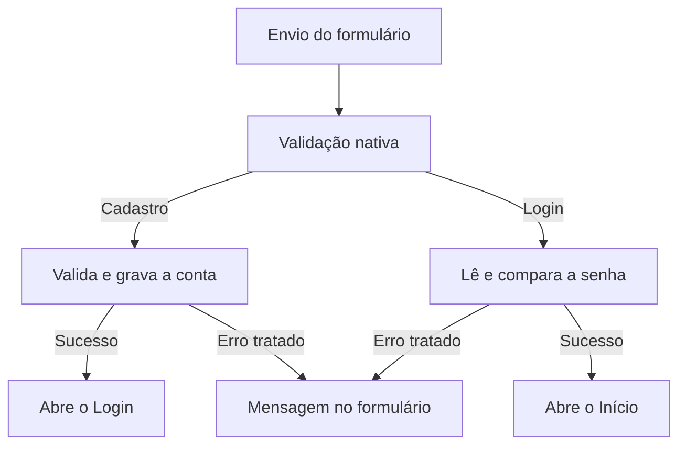

# Sintaxe Labs

O Sintaxe Labs é um site educacional de programação. A [página inicial](index.html) apresenta a proposta de organizar o estudo por tecnologia e nível, do básico ao avançado.

Na versão atual, o [catálogo de trilhas](html/trilhas.html) organiza o conteúdo introdutório em duas trilhas, Front-end e Back-end. Ao todo, são seis aulas de primeiros passos, cada uma com explicação, exemplo de código, uma proposta de prática e duas questões de múltipla escolha com correção imediata.

Além das aulas, o site oferece cadastro e validação de conta no navegador, uma página Admin para gerenciar uma lista local de usuários e dois currículos acessíveis pelo rodapé da página inicial.

## Desenvolvedores

João Francisco Martins Simão  
Pedro Augusto Garcias Santos

## Como abrir o projeto

Abra [index.html](index.html) no navegador para navegar pelas páginas. Para testar cadastro, login e Admin, sirva a raiz do projeto com um servidor HTTP estático local e acesse as páginas pelo mesmo endereço e porta. Isso mantém os formulários sob uma única origem para o `localStorage`. O site é entregue em arquivos HTML, CSS e JavaScript que o navegador lê diretamente, sem etapa de compilação ou instalação de pacotes.

## Estrutura de diretórios

```text
projeto-sintaxe-labs-web-front-end/
├── README.md
├── index.html
├── css/
│   └── style.css
├── curriculos/
│   ├── curriculo-joao/
│   │   ├── index.html
│   │   ├── style.css
│   │   └── imagem/
│   │       └── foto-joao.jpg
│   └── curriculo-pedro/
│       ├── index.html
│       ├── style.css
│       └── imagem/
│           └── foto-pedro.jpg
├── html/
│   ├── admin.html
│   ├── backend.html
│   ├── c.html
│   ├── cadastro.html
│   ├── cpp.html
│   ├── css.html
│   ├── frontend.html
│   ├── html.html
│   ├── java.html
│   ├── javascript.html
│   ├── login.html
│   └── trilhas.html
├── images/
│   ├── icones-svg/
│   │   ├── foguete.svg
│   │   ├── pessoa.svg
│   │   ├── projeto.svg
│   │   └── tarefa.svg
│   ├── imagens-jpg/
│   │   ├── imagem01.jpg
│   │   ├── imagem02.jpg
│   │   ├── imagem03.jpg
│   │   ├── java.jpg
│   │   └── javascript.jpg
│   └── imagens-png/
│       ├── c.png
│       ├── cpp.png
│       ├── css.png
│       ├── html.png
│       ├── imagem04.png
│       └── imagem05.png
└── js/
    ├── admin.js
    ├── conta.js
    └── exercicios.js
```

## Páginas e navegação

### Página inicial e material de estudo

| Página | Conteúdo e navegação |
| --- | --- |
| [Início](index.html) | Apresentação, funcionamento do estudo, proposta do projeto, público e chamada “Começar agora”. O menu abre Trilhas, Cadastro, Login e Admin. A chamada também abre Trilhas. O rodapé liga ao repositório e aos dois currículos. Os itens de apresentação e seção no rodapé são texto. |
| [Trilhas](html/trilhas.html) | Dois cartões ilustrados, Front-end e Back-end, cada um com descrição e link para sua lista de tecnologias. |
| [Front-end](html/frontend.html) | Lista ordenada de três cartões com descrição, imagem e entrada direta nas aulas de HTML, CSS e JavaScript. |
| [Back-end](html/backend.html) | Lista ordenada de três cartões com descrição, imagem e entrada direta nas aulas de C, C++ e Java. |

As páginas usam cabeçalho, conteúdo principal e rodapé. A página inicial usa `nav` no menu e `section` para organizar o conteúdo. Nas páginas de estudo, as seções identificadas por `.secao-trilhas`, `.secao-tecnologias` e `.secao-aula` delimitam o conteúdo principal. O catálogo usa cartões `.card-trilha`. As listas ordenadas de tecnologias usam `.lista-tecnologias` e `.card-tecnologia`.

Cada aula contém um cabeçalho com título e passo da trilha, dois `article` de classe `.bloco-conteudo`, passos em lista, exemplos de código em `pre` e `code` e uma proposta em `.dica-pratica` para quem quer praticar por conta própria. Em seguida, a seção “Teste seus conhecimentos” apresenta duas questões com três alternativas cada, antes dos links em `.navegacao-aula`. Qualquer aula pode ser aberta diretamente da lista da trilha. “Concluir e ver trilhas” retorna ao catálogo sem gravar progresso.

| Aula | Exemplo e proposta de prática | Temas das questões | Navegação ao fim da aula |
| --- | --- | --- | --- |
| [HTML](html/html.html) | Montar uma página com título, parágrafo e link. Acrescentar subtítulo e lista. | Finalidade do HTML e tag de link. | Lista de tecnologias ou CSS |
| [CSS](html/css.html) | Vincular uma folha de estilos e aplicar regras ao corpo, título e parágrafos. Criar uma classe de destaque. | Inclusão de uma folha externa e seletor de classe. | HTML ou JavaScript |
| [JavaScript](html/javascript.html) | Ligar um script ao HTML e alterar um título ao clicar em um botão. Criar um contador de cliques. | Posição da tag `script` e tratamento do evento de clique. | CSS ou catálogo de trilhas |
| [C](html/c.html) | Compilar e executar um programa com GCC. Somar dois inteiros. | Cabeçalho de entrada e saída e função para exibir texto no terminal. | Lista de linguagens ou C++ |
| [C++](html/cpp.html) | Compilar com G++ e imprimir uma saudação. Ler o nome no terminal. | Biblioteca de entrada e saída e exibição de texto. | C ou Java |
| [Java](html/java.html) | Compilar e executar a classe `Main` com as ferramentas do JDK. Criar e chamar um método de saudação. | Função da JVM e relação entre o nome do arquivo e o da classe pública. | C++ ou catálogo de trilhas |

### Cadastro, login e Admin

As três páginas usam formulários com `label` ligado ao `id` dos campos e carregam seus scripts ao fim do `body`, após os elementos que o JavaScript consulta. Cadastro e login têm links entre si e para o Início. Admin pode ser aberto diretamente pelo menu inicial, sem verificação de conta ou de permissão.

| Página e script | Formulário, campos e controles | Resultado na interface |
| --- | --- | --- |
| [Cadastro](html/cadastro.html) e [conta.js](js/conta.js) | `#formulario-cadastro`, com `#nome`, `#sobrenome`, `#email`, `#senha` e `#confirmacao-senha`. Todos são obrigatórios. O botão “Cadastrar” envia o formulário. | O script usa `#mensagem-conta` para exibir os erros tratados. Um cadastro salvo abre a página de login. |
| [Login](html/login.html) e [conta.js](js/conta.js) | `#formulario-login`, com `#email` e `#senha` obrigatórios. O botão “Entrar” envia o formulário. | O script usa `#mensagem-conta` para os erros. Ao validar os dados, redireciona à página inicial. |
| [Admin](html/admin.html) e [admin.js](js/admin.js) | `#formulario-usuario`, com `#nome-usuario` e `#email-usuario` obrigatórios. “Cadastrar” envia o formulário e “Limpar campos” é o reset nativo dos dois campos. Fora do formulário, `#pesquisa-usuario` filtra a lista e `#excluir-todos` remove os cadastros. | `#lista-usuarios` é uma lista não ordenada preenchida pelo script, com data, nome, e-mail e botão “Excluir” por item. `#mensagem-lista` informa quando a lista está vazia ou a busca não encontra resultados. |

As áreas de mensagem usam `role="status"`. Nas duas telas de conta, os campos de senha usam `type="password"` e a estilização oculta `.mensagem-conta` enquanto estiver vazia. Os campos de e-mail nas três telas usam `type="email"`, com validação nativa do navegador.

### Currículos

| Página | Estrutura e dependências |
| --- | --- |
| [Currículo de João Francisco](curriculos/curriculo-joao/index.html) | Organiza o perfil em `main.curriculo-container`, com um `aside.perfil-info` para foto, contatos e habilidades. A seção `.main-content` reúne resumo, projetos e educação. Usa sua própria [folha de estilos](curriculos/curriculo-joao/style.css) e [foto](curriculos/curriculo-joao/imagem/foto-joao.jpg). Os links sociais apontam para perfis externos. |
| [Currículo de Pedro Augusto](curriculos/curriculo-pedro/index.html) | Apresenta nome, cargo, foto, contatos, habilidades, resumo, experiência e educação em uma coluna de títulos, parágrafos e listas. Usa sua própria [folha de estilos](curriculos/curriculo-pedro/style.css), [foto](curriculos/curriculo-pedro/imagem/foto-pedro.jpg) e a fonte Roboto via Google Fonts. Os links de LinkedIn e GitHub apontam para `#`. |

## Arquitetura, estilos e recursos

O projeto é um site estático com várias páginas. O HTML define as telas e seus links relativos. O [CSS compartilhado](css/style.css) atende a página inicial e todas as páginas de `html/`. Os três scripts usam APIs nativas do navegador. [conta.js](js/conta.js) atende cadastro e login, [admin.js](js/admin.js) gerencia a lista administrativa e [exercicios.js](js/exercicios.js) corrige as questões das seis aulas. A aplicação não possui chamadas a APIs remotas, código de servidor, banco de dados, framework ou biblioteca JavaScript. Os currículos são páginas estáticas com estilos próprios e sem scripts.

| Estilo | Efeito na interface |
| --- | --- |
| `:root`, `body`, `main`, `.largura-pagina` | As variáveis de cor mantêm a paleta de fundos claros, texto escuro, destaque azul e detalhe amarelo. A fonte do site usa a pilha Inter, `system-ui` e `sans-serif`, com fontes monoespaçadas nos exemplos e nos rótulos da inicial. Não há importação da fonte Inter. O layout vertical em Flexbox permite que o conteúdo principal ocupe o espaço disponível e posicione o rodapé abaixo. O contêiner central limita a largura a 1200 px e reserva espaço nas laterais. |
| `.cabecalho`, `.conteudo-cabecalho`, `.menu-principal`, `.rodape`, `.conteudo-rodape` | Mantêm a marca, o espaçamento e a organização do cabeçalho e rodapé. As linhas podem quebrar conforme a largura. O menu destaca os itens no `:hover` com texto azul e borda inferior amarela, e aplica o mesmo tratamento ao link ativo marcado por `aria-current="page"`. Links do rodapé são sublinhados ao passar o ponteiro. |
| `.duas-colunas`, `.coluna`, `.lista-etapas`, `.grade-trilhas`, `.card-tecnologia` | Usam Flexbox e quebra de linha para reorganizar colunas, cartões e etapas conforme o espaço. Apesar do nome `.grade-trilhas`, a regra usa Flexbox. A folha compartilhada não declara CSS Grid ou media queries. As imagens dos cartões têm recorte com `object-fit: cover`. |
| `.bloco-conteudo`, `.bloco-codigo`, `.dica-pratica`, `.botao-destaque`, `.botao-trilha` | Separam os blocos de leitura, dão fundo escuro e rolagem horizontal aos exemplos longos e destacam as propostas de prática. Cartões e botões usam variações de cor, sombra ou posição no `:hover`. A folha compartilhada não define um estado `:focus` próprio. |
| `.bloco-quiz`, `.pergunta-quiz`, `.opcoes-quiz`, `.opcao-btn`, `.feedback-quiz` | Separam as questões, empilham os botões e reservam espaço para o retorno abaixo das alternativas. As classes aplicadas pelo script destacam a alternativa selecionada e a mensagem em verde para acerto ou vermelho para erro. |
| `.conteudo-conta`, `.conteudo-admin`, `.acoes-admin`, `#lista-usuarios` | Limitam a largura dos formulários, organizam rótulos e campos e permitem a quebra da linha de botões no Admin. Na lista, `overflow-wrap: break-word` permite quebrar textos longos, e cada botão de exclusão tem espaçamento próprio. |
| CSS dos currículos | O de João usa Arial e Flexbox para colocar a barra lateral escura ao lado do conteúdo. Em até 768 px, as colunas se empilham. Em até 480 px, margens, espaçamentos e foto ficam menores. O de Pedro usa Roboto no corpo, Georgia em títulos, `#nome-principal` para centralizar o nome, `.cargo` para destacar o cargo e um seletor de atributo `alt` para circular a foto. Seus links mudam de cor e são sublinhados no `:hover`. |

Os ícones SVG `tarefa`, `projeto`, `pessoa` e `foguete` são carregados como imagens pelos rótulos e pela chamada da página inicial. Os JPG `imagem01`, `imagem02` e `imagem03` ilustram, respectivamente, a apresentação, o projeto e o público. Os PNG `imagem04` e `imagem05` ilustram os cartões Front-end e Back-end. Nas listas das trilhas, os cartões usam os PNG de HTML, CSS, C e C++ e os JPG de JavaScript e Java. As fotos dos currículos permanecem em suas próprias pastas.

Google Fonts é usado somente no currículo de Pedro, com conexões a `fonts.googleapis.com` e `fonts.gstatic.com`. Os links externos nos rodapés e currículos são destinos de navegação. Ferramentas como GCC, G++ e JDK aparecem nas aulas para executar exemplos à parte.

### Créditos das imagens da página inicial

- Lukas Blazek — https://www.pexels.com/pt-br/foto/caneta-retratil-azul-574070/
- Daniil Komov — https://www.pexels.com/pt-br/foto/close-up-de-tela-de-computador-com-codigo-exibido-34803966/
- cottonbro studio — https://www.pexels.com/pt-br/foto/escritorio-tecnologia-teclado-negocio-6804613/

## JavaScript, regras e fluxo de dados

### Exercícios de múltipla escolha

Cada uma das seis aulas carrega [exercicios.js](js/exercicios.js) ao fim do `body`. O próprio HTML reúne o enunciado, os botões `.opcao-btn` e o parágrafo `.feedback-quiz` em um bloco `.pergunta-quiz`. A alternativa certa vem marcada com `data-correta="true"`.

Ao clicar em uma alternativa, o script limpa as marcações da tentativa anterior naquela questão e verifica `botao.dataset.correta`. Se a resposta estiver certa, aplica `.correta` ao botão e mostra “Correto! Muito bem.”. Se estiver errada, aplica `.incorreta` e mostra “Resposta incorreta. Tente novamente!”. Cada questão tem seu próprio retorno e permite novas tentativas. As respostas ficam na página atual e são descartadas ao recarregá-la. A navegação entre aulas fica disponível independentemente das respostas.

### Cadastro e login

[conta.js](js/conta.js) mantém referências para os formulários, o e-mail, a senha e a área de mensagem. O script liga o evento `submit` à função correspondente apenas se encontrar o formulário na página. As duas funções recebem o evento, cancelam o envio padrão e leem os valores dos campos.

| Função | Regras e resultado |
| --- | --- |
| `obterChaveConta()` | Lê o e-mail do formulário, converte para minúsculas e devolve o prefixo próprio daquela conta. Cadastro e login usam a mesma função para localizar os dados. |
| `cadastrarConta(evento)` | O formulário exige senha com pelo menos oito caracteres. O script remove espaços das extremidades de nome e sobrenome e rejeita valores vazios após essa limpeza. Compara a senha e a confirmação exatamente como foram digitadas. Converte o e-mail para minúsculas ao montar a chave e considera o e-mail cadastrado quando já existe a chave de senha correspondente. Se a validação passar, grava nome completo e senha e abre `login.html`. Em caso de falha de armazenamento, exibe mensagem na própria página. |
| `entrarNaConta(evento)` | Monta a mesma chave com o e-mail em minúsculas, lê a senha e faz uma comparação exata. Um e-mail ausente e uma senha incorreta recebem a mesma mensagem. Uma falha de leitura recebe mensagem específica. Com os dados válidos, a função abre `../index.html`. O redirecionamento é o único efeito do login bem-sucedido sobre a navegação. |

### Administração da lista de usuários

[admin.js](js/admin.js) mantém referências para formulário, campos, busca, lista, mensagem e botão de exclusão geral. Ao abrir a página, executa a migração de dados legados e renderiza os usuários. Depois, `submit` cadastra, `input` refaz a pesquisa e `click` dispara as exclusões. O botão de cada registro mantém o ID do usuário associado ao seu evento de clique.

| Função | Regras e resultado |
| --- | --- |
| `lerCadastros()` | Lê a chave `sintaxe-labs-usuarios` e converte a string JSON em objeto. Quando a chave está ausente, retorna lista vazia e `proximoId` igual a zero. |
| `salvarCadastros(cadastros)` | Recebe o objeto com a lista e o contador, converte para JSON e grava na mesma chave. |
| `migrarCadastrosAntigos()` | Se houver contador legado maior que zero e a chave atual estiver ausente, percorre os IDs antigos e importa os registros com nome e e-mail disponíveis, preservando ID e a data formatada armazenada. Usa o total antigo como próximo ID. Ao final, remove o contador e as chaves antigas correspondentes ao padrão de nome, e-mail e data. |
| `cadastrarUsuario(evento)` | Cancela o envio padrão, remove espaços nas extremidades do nome e mostra um alerta se ele ficar vazio. Usa a data local obtida com `Date` em formato dia/mês/ano, sem zeros de preenchimento. Adiciona o registro ao fim da lista com `proximoId`, incrementa o contador e salva. Limpa nome, e-mail e pesquisa antes de redesenhar a lista. O fluxo permite cadastrar mais de um registro com o mesmo e-mail. |
| `mostrarUsuarios()` | Limpa a lista e a mensagem e recria os itens na ordem armazenada. Remove espaços nas extremidades da pesquisa e compara o trecho digitado com o nome ou e-mail em maiúsculas, ignorando diferenças de caixa. Cria cada `li`, insere os dados com `createTextNode` e adiciona o botão “Excluir” com rótulo acessível. Usa um contador de correspondências para distinguir lista vazia de pesquisa sem resultados. |
| `excluirUsuario(id)` | Procura pelo ID recebido, remove o registro correspondente, salva a lista e redesenha a interface com a pesquisa atual. |
| `excluirTodosUsuarios()` | Remove a chave da lista e do contador, limpa a pesquisa e redesenha a interface vazia. A próxima inclusão começa com ID zero. |

A exclusão individual e a exclusão geral são executadas ao clicar no respectivo botão, sem etapa de confirmação. “Limpar campos” atua apenas no formulário e não altera os registros. A busca filtra a apresentação e mantém os dados armazenados.

### Persistência

Os formulários de cadastro, login e Admin usam `localStorage`, com dados vinculados à origem e ao perfil do navegador. Cadastro e login compartilham as chaves de conta. O Admin mantém um cadastro independente e serializa sua lista em JSON dentro do `localStorage`. O código do projeto não usa `sessionStorage`, cookies, IndexedDB nem arquivos JSON para persistência. Os exercícios não gravam respostas, pontuação ou progresso.

| Chave | Valor e uso |
| --- | --- |
| `sintaxe-labs-conta-<email>-nome` | Nome completo como texto, gravado no cadastro. O login não consulta esse campo. |
| `sintaxe-labs-conta-<email>-senha` | Senha em texto simples, gravada no cadastro e comparada no login. O login não cria sessão nem protege as páginas. |
| `sintaxe-labs-usuarios` | Objeto serializado com `usuarios` e `proximoId`. Cada entrada tem `id`, `nome`, `email` e `data`. |
| `sintaxe-labs-proximo-usuario` e `sintaxe-labs-usuario-<id>-<campo>` | Formato legado tratado no carregamento do Admin. A migração lê `nome`, `email` e `dataFormatada` e inclui `data` entre os sufixos removidos na limpeza. |



No Admin, o cadastro ou a exclusão altera o objeto persistido ou remove sua chave. Em seguida, `mostrarUsuarios()` lê o estado atual e atualiza a lista. A pesquisa vai diretamente do evento `input` à renderização, sem gravação. A abertura inicial executa a migração antes da primeira leitura para renderizar.

## Conclusão

O percurso de estudo parte da página inicial, passa pelo catálogo e chega a uma das seis aulas, cada uma com questões corrigidas no navegador. O HTML reúne o conteúdo, as alternativas e a navegação. A folha compartilhada mantém a apresentação do site, e os scripts cuidam da correção dos exercícios, da validação de contas e do gerenciamento da lista do Admin.
